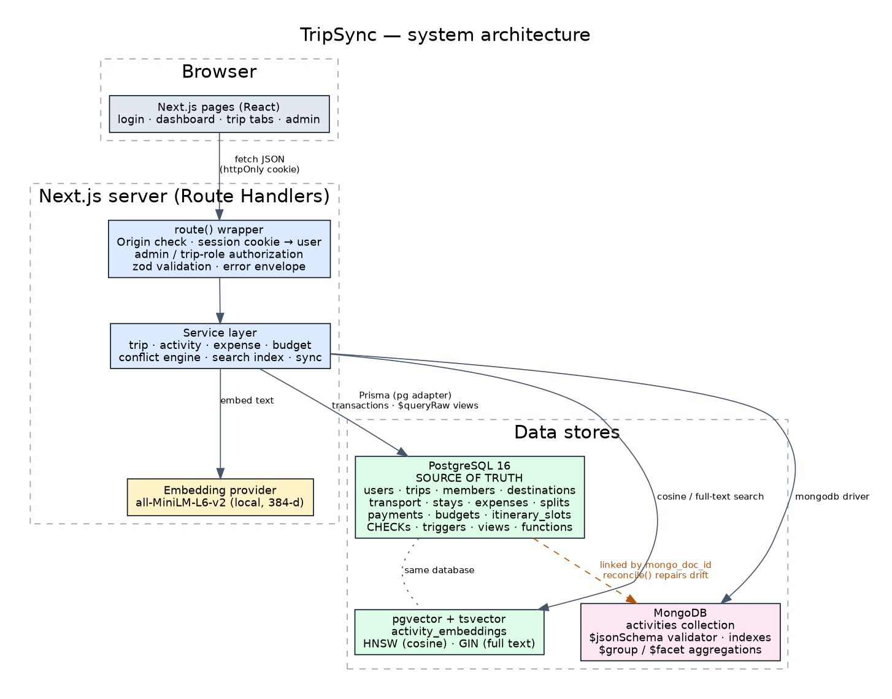

# TripSync — Collision-Free Group Trip Planner

TripSync is a multi-day trip-planning and logistics application. Groups plan itineraries, book transport and stays,
split expenses and are **warned automatically when plans collide** (an activity that overlaps a bus departure with its
boarding buffer, a hotel check-out, or another activity). Activities can be found by *meaning* ("a peaceful morning near
ancient ruins") using vector search.

> **DBMS Level 3 project.** The application deliberately uses three data models, each for the data it suits best:
> **PostgreSQL** (relational source of truth), **MongoDB** (flexible activity documents) and **pgvector** (semantic search).
> Everything about the database design is documented in [`docs/`](docs/README.md).

---

## Problem statement

Group trips are planned across chat apps, spreadsheets and booking e-mails. Nothing connects them, so people discover
too late that a sightseeing slot overlaps check-out, that the bus leaves before lunch ends, or that nobody knows who owes whom.
TripSync keeps destinations, bookings, activities, budgets and expenses in one consistent, permission-controlled place and
checks the whole schedule for them. Full problem statement, objectives, scope and functional requirements:
[`docs/01-problem-and-requirements.md`](docs/01-problem-and-requirements.md).

## Key features

| Area | What it does |
|---|---|
| **Accounts & roles** | Registration/login (bcrypt, httpOnly session cookie). Global roles **user / admin**; per-trip roles **organizer / traveler (member) / viewer**. |
| **Trips** | Create, edit, delete; status workflow; search, filter and sort on the dashboard; per-user statistics. |
| **Logistics** | Destinations, transport (flight/train/bus/car/ferry) and accommodation with booking references and costs; edit/delete everywhere. |
| **Schedule assistant** | Detects hard conflicts (activity vs. transport incl. boarding buffer, vs. hotel check-in/check-out, transport vs. transport) and soft conflicts (activity vs. activity); suggests the nearest free slot and applies it in one click. |
| **Budget & expenses** | Planned budget per category, exact-to-the-paisa expense splitting, balances, one-click settlement (recorded as payments). |
| **Collaboration** | Invite members by e-mail, change roles, leave/remove; every API call checks membership. |
| **Search** | Semantic search (pgvector cosine similarity) with an *honest* full-text fallback that is labelled as such. |
| **Admin** | System health across the three stores, one-click cross-database reconcile, user suspension. |

## Technology stack

Next.js 16 (App Router, Route Handlers) · React 19 · TypeScript · Tailwind CSS 4 · PostgreSQL 16 + **pgvector** · Prisma 6 (`pg` driver adapter)
· MongoDB (official driver) · zod 4 · jose (JWT) · bcryptjs · local sentence-transformer `Xenova/all-MiniLM-L6-v2` (via `@xenova/transformers`)
· Vitest · Selenium (browser tests).

## Architecture in one picture



Details, authentication/authorization design and the cross-database consistency strategy: [`docs/10-architecture-security.md`](docs/10-architecture-security.md).

---

## Getting started

### Prerequisites

* Node.js **≥ 20.9** (22 recommended) and npm
* PostgreSQL **15+** with the **pgvector** extension available (`postgresql-16-pgvector` on Ubuntu, or the `pgvector/pgvector:pg16` Docker image)
* MongoDB **6+**
* Internet access **once** for the first semantic search (downloads the ~25 MB embedding model from the Hugging Face hub and caches it)

Quickest way to get both databases: `POSTGRES_PASSWORD=choose-one docker compose up -d` (see `docker-compose.yml`).

### 1. Install

```bash
npm install            # also runs `prisma generate`
cp .env.example .env   # then edit .env: set real passwords and a long random JWT_SECRET
```

Generate a secret with `openssl rand -base64 48`. **Never commit `.env`** (it is git-ignored; only `.env.example` is tracked).

### 2. Create the schema

```bash
# PostgreSQL: the role in DATABASE_URL needs permission to CREATE EXTENSION vector (superuser, or run once as superuser:
#   psql -d tripsync -c 'CREATE EXTENSION IF NOT EXISTS vector;')
npm run db:migrate     # = prisma migrate deploy  (applies prisma/migrations/* in order)
npm run db:mongo       # creates the MongoDB collection, JSON-schema validator and indexes (idempotent)
```

Use `migrate deploy`, not `migrate dev`: the migrations contain triggers, views, functions and GIN/HNSW indexes that Prisma's
diff engine does not model.
(If you cannot run Prisma's schema engine, the four files in `prisma/migrations/*/migration.sql` are plain SQL and can be applied in
order with `psql -f`; this is exactly how the automated tests build their database.)

### 3. Seed demo data (optional, idempotent)

```bash
npm run db:seed        # needs SEED_DEMO_PASSWORD and SEED_ADMIN_PASSWORD in .env
npm run db:seed -- --reset   # delete and recreate the demo trip
```

Creates four accounts (passwords come from *your* `.env`, hashed with bcrypt at seed time — nothing is hard-coded):
`ronak@example.com` (organizer), `arjun@example.com` (traveler), `priya@example.com` (viewer) and the admin from `SEED_ADMIN_EMAIL`,
plus the "Hampi Heritage Tour" trip with a deliberate check-out collision to demonstrate the schedule assistant.

### 4. Run

```bash
npm run dev            # http://localhost:3000  (development)
npm run build && npm start   # production
curl localhost:3000/api/health   # PostgreSQL, pgvector, MongoDB, embedding status
```

After a bulk import, or if the embedding model was unavailable when activities were created, run `npm run db:reindex`
(or the admin page's *Run reconcile*) to generate the missing embeddings and repair cross-database drift.

---

## Testing

| Command | What it runs | Needs |
|---|---|---|
| `npm run lint` / `npm run typecheck` | ESLint, TypeScript | – |
| `npm test` | 36 unit tests (money, time, validation, conflict engine, error mapping, rate limiter) | – |
| `npm run test:db` | 39 database tests on a throw-away `tripsync_test` DB built from the migrations: CHECKs, triggers, views, functions, transactions, vector/full-text indexes, search-index service | PostgreSQL + pgvector, MongoDB |
| `npm run test:api` | 45 end-to-end HTTP tests against the running app and real databases | app on `API_BASE_URL` (default `:3000`), migrated + seeded DBs |
| `npm run test:ui` | 20-step real-browser journey (Selenium + Firefox) that also writes the screenshots in `docs/screenshots` | app on `BASE_URL`, Firefox + geckodriver (`FIREFOX_BIN`, `GECKODRIVER_PATH`) |
| `npm run verify:embeddings` | loads the real embedding model and checks it ranks related text higher | internet (first run) |

The tests that touch the databases create their own users (`@apitest.local`, `@uitest.local`) and delete everything they created.
**Actual results of the last run, with exact numbers and the known gaps, are in [`docs/12-testing.md`](docs/12-testing.md).**

## Project structure

```
prisma/schema.prisma            Prisma models (typed client)
prisma/migrations/*/            SQL DDL: tables, CHECKs, triggers, views, functions, GIN + HNSW indexes
src/app/                        Pages (landing, login, register, dashboard, trip, admin, architecture)
src/app/api/                    Route Handlers (see docs/11-api-reference.md)
src/components/                 Navbar, UI primitives, trip tabs
src/lib/api/                    route() wrapper (auth + authorization + errors), response envelope
src/lib/auth/                   JWT + cookie session
src/lib/db/                     PostgreSQL (Prisma) and MongoDB clients
src/lib/services/               Business logic: trips, activities, expenses, budget, conflict engine, search index, sync
src/lib/utils/                  money (exact decimals), time (wall-clock policy), zod schemas
scripts/                        setup-mongo, seed, reindex, verify-embeddings, diagram/dictionary generators
tests/{unit,db,api,e2e}/        Test suites
docs/                           Full project documentation, SQL/Mongo demos with real output, diagrams, screenshots
```

## API summary

JSON everywhere; success `{ "success": true, "data": … }`, failure `{ "success": false, "error": { "code", "message", "details?" } }`.
Full table in [`docs/11-api-reference.md`](docs/11-api-reference.md). Examples:
`POST /api/auth/login`, `GET /api/trips`, `POST /api/trips/:id/activities`, `GET /api/trips/:id/conflicts`,
`POST /api/trips/:id/expenses`, `POST /api/trips/:id/settlements`, `POST /api/trips/:id/search`, `POST /api/admin/reconcile`.

## Security summary

bcrypt (cost 12) passwords, additionally constrained **in the database** to bcrypt format · httpOnly + SameSite=Lax cookie (Secure over HTTPS) ·
identity and role always re-read from the database per request (suspension is immediate) · membership/role check on every trip resource
(404 for non-members, so existence is not leaked) · zod validation + database CHECK/trigger/FK constraints · parameterised queries only ·
Origin check on state-changing requests · login/registration rate limiting · no stack traces or SQL in responses · secrets only in environment variables.

## Known limitations & honest notes

* **Semantic search model:** the embedding model is downloaded from the Hugging Face hub on first use. If it cannot be loaded, search
  automatically falls back to PostgreSQL full-text search and the UI **says so**. The semantic path was verified with a deterministic
  stand-in for the model (storage, ranking, sync logic); the real model could not be downloaded in the environment where this work was done.
  Run `npm run verify:embeddings` on your machine to confirm it end to end.
* **`prisma migrate deploy`** could not be executed where this work was done (the Prisma engine download host was unreachable). The migrations were applied with `psql` in order,
  and the folder follows Prisma's layout, but please run `npm run db:migrate` once yourself. The Prisma client uses the `pg` driver adapter (`engineType = "client"`), so no engine binary is needed at runtime.
* `npm audit` reports 8 findings (1 critical, 7 high). All sit in the transitive dependencies of `@xenova/transformers` v2 (unmaintained: `protobufjs`, `sharp`, `onnxruntime-web`) and in the Prisma CLI's config loader (a build-time tool). The app only embeds its own trusted text — it never parses user-supplied images or protobuf. The maintained successor `@huggingface/transformers` v3 would clear most of them but downloads native binaries from `nuget.org` at install time, which I could not verify, so the original package was kept.
* Rate limiting is in-memory (single process). Behind several instances use a shared store.
* Sessions are stateless JWTs: *logout* clears the cookie but a stolen token stays valid until expiry (suspension of the account is immediate, though).
* Schedule times are **wall-clock times at the trip location** with no timezone conversion (documented policy; one timezone per trip).
* Settlement pays each member's gross outstanding shares; it does not compute minimal-transfer netting between members.
* Members are added by the e-mail of an existing account (no e-mail invitation flow).
* The UI was browser-tested in Firefox (headless) only, with no automated accessibility audit.
* `docker-compose.yml` was written but not run in the build environment.
* Team member responsibilities and Git contribution history belong to *you*: see the template in [`docs/15-conclusion-and-contributions.md`](docs/15-conclusion-and-contributions.md).

## Future enhancements

E-mail invitations · minimal-transfer settlement · real-time collaboration (SSE/WebSocket) · multi-currency expenses with stored exchange rates ·
map view with geospatial queries · per-trip timezones · offline mode · Redis-backed rate limiting and token revocation.

## Requirement compliance

A line-by-line mapping of the official DBMS Level 3 requirements to this implementation is in
[`docs/13-requirements-compliance.md`](docs/13-requirements-compliance.md).
