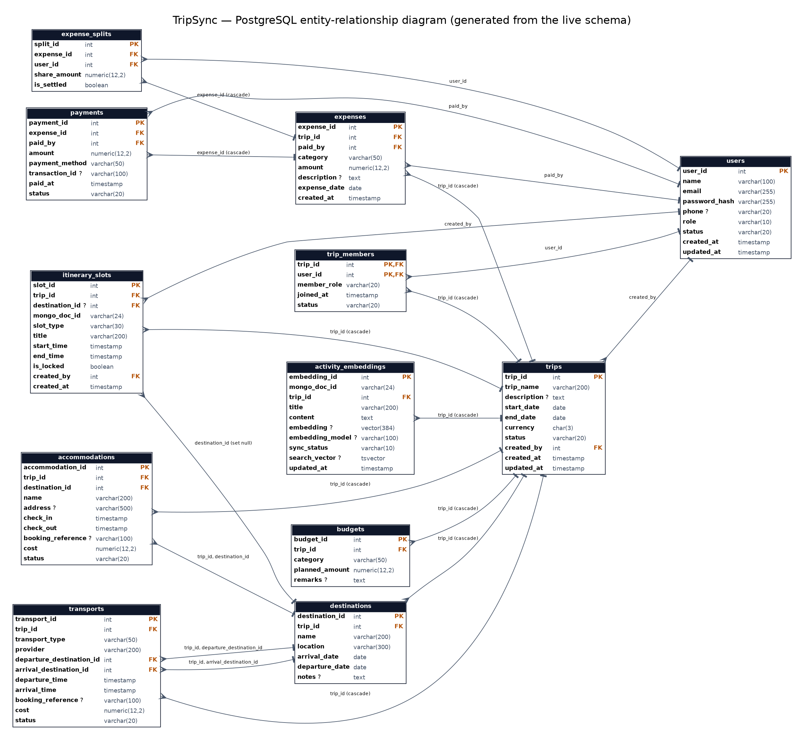
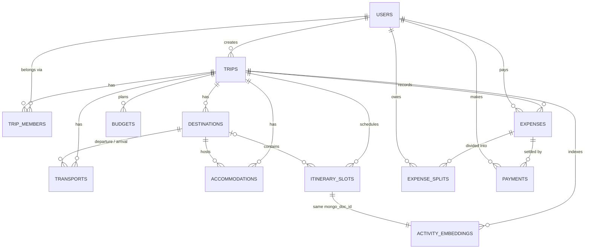

# 2. ER diagram

The full diagram below is **generated from the live PostgreSQL schema** (`npm run docs:er`), so it cannot drift from the implementation.
Source: [`diagrams/er-diagram.dot`](diagrams/er-diagram.dot) · vector: [`diagrams/er-diagram.svg`](diagrams/er-diagram.svg).

*(`?` = nullable column, `PK`/`FK` = primary/foreign key; labels on the arrows show the foreign-key columns and the delete rule.)*

## Entities and relationships

| Relationship | Cardinality | Implemented by |
|---|---|---|
| User **creates** Trip | 1 : N | `trips.created_by → users` |
| User **belongs to** Trip | M : N (with attributes *role*, *status*, *joined_at*) | associative entity `trip_members` (composite PK) |
| Trip **has** Destination / Transport / Accommodation / Budget line / Expense / Activity slot | 1 : N each | `trip_id` FK, `ON DELETE CASCADE` |
| Destination **is departure / arrival of** Transport | 1 : N (two roles) | `transports.(trip_id, departure_destination_id)` and `(trip_id, arrival_destination_id)` → `destinations.(trip_id, destination_id)` |
| Destination **hosts** Accommodation | 1 : N | composite FK `(trip_id, destination_id)` |
| Destination **contains** Activity slot | 1 : N (optional) | `itinerary_slots.destination_id`, `ON DELETE SET NULL` |
| User **pays** Expense | 1 : N | `expenses.paid_by` |
| Expense **is divided into** Split | 1 : N | `expense_splits.expense_id`, unique `(expense_id, user_id)` |
| User **owes** a Split | 1 : N | `expense_splits.user_id` |
| Expense **is settled by** Payment | 1 : N | `payments.expense_id` |
| Activity slot **is described by** a MongoDB document | 1 : 1 | `itinerary_slots.mongo_doc_id` (ObjectId, unique) |
| Activity slot **is indexed in** Search index | 1 : 1 | `activity_embeddings.mongo_doc_id` (unique) |

### Design notes
* **Composite foreign keys** `(trip_id, destination_id)` make it *impossible* for a booking to reference a destination of another trip — an integrity rule enforced by the schema, not by application code.
* `trip_members` is the many-to-many resolution; its `member_role` carries the per-trip authorization role.
* `itinerary_slots` + MongoDB document form one logical entity split across two stores (see [10-architecture-security.md](10-architecture-security.md)).

## Compact Mermaid version (renders on GitHub)

