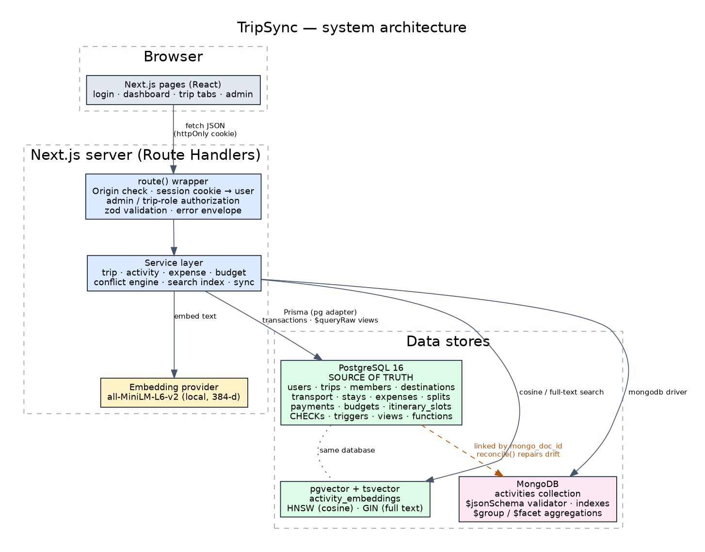

# 10. System architecture, authentication, authorization and security

## Layers
1. **UI (Next.js App Router, client components).** Pages call a small typed `api()` helper; they never touch a database. Styling is the project's existing sharp/slate design (shared pieces in `src/components/ui.tsx`).
2. **Route Handlers (`src/app/api/**`).** Each file only wires an HTTP verb to `route({...}, handler)` and a service call.
3. **`route()` wrapper (`src/lib/api/route.ts`).** For *every* request: Origin check on state-changing methods → resolve the user from the session cookie → admin check → trip membership/role check → JSON-body parsing with zod → uniform error envelope.
4. **Services (`src/lib/services`).** All business rules (conflict engine, splits, settlement, search index, sync). Pure logic (`conflictEngine`, `money`, `time`) has no I/O and is unit-tested.
5. **Data access.** Prisma (`pg` adapter) for PostgreSQL, raw parameterised SQL for views/functions/pgvector, the MongoDB driver for documents.

## Authentication
* Registration/login validate input with zod, **bcrypt cost 12**; passwords limited to 72 bytes (bcrypt's real limit) with letter+digit rule.
* A signed **JWT (HS256, `jose`)** holds only the user id and is stored in an **httpOnly, SameSite=Lax** cookie, `Secure` whenever the request arrived over HTTPS (directly or via `x-forwarded-proto`). The token is never returned in a response body and never touches `localStorage`.
* **The user id is never taken from request data.** Every request re-reads the user row, so role changes and **suspension take effect immediately**; an invalid, forged or expired token is a plain 401.
* Login errors are identical for "unknown e-mail" and "wrong password", and a dummy bcrypt comparison equalises timing.
* `JWT_SECRET` is mandatory (≥ 32 chars); there is **no fallback secret** (the original code had one).

## Authorization (two layers of roles)
| Scope | Roles | Enforced by |
|---|---|---|
| Global | `user`, `admin` (`users.role`, CHECK-constrained) | `route({ admin: true })` → 403 |
| Per trip | `organizer`, `member` (UI: *traveler*), `viewer` (`trip_members.member_role`) | `route({ trip: [...] })` |

| Action | Organizer | Traveler | Viewer | Non-member |
|---|---|---|---|---|
| Read trip data | ✔ | ✔ | ✔ | 404 |
| Edit/delete trip, destinations, transport, stays, budget, members | ✔ | – | – | 404 |
| Add activities / expenses | ✔ | ✔ | – | 404 |
| Change or delete an activity / expense | any | only own (activity: creator, expense: payer) | – | 404 |
| Record an expense paid by someone else | ✔ | – | – | 404 |
| Settle another member's dues | ✔ | self only | – | 404 |
Administrators manage the *system* (health, reconcile, suspend/reactivate users) but **cannot read users' private trips** (they get 404 like any non-member) — a deliberate privacy decision, covered by a test.

**Insecure-direct-object-reference defence:** the trip id in the URL is checked against the *session user's* membership; every child lookup is also filtered by that trip id (`findFirst({ where: { id, tripId } })`); bodies that reference other rows (destination ids, split user ids, payer) are validated to belong to the same trip, with composite FKs / triggers behind them. The API tests attempt exactly these attacks (foreign destination in a transport, my destination id through another user's trip, stranger reads/writes on 11 resources).

## Other protections
| Concern | Measure |
|---|---|
| SQL injection | Prisma parameter binding and tagged-template `$queryRaw` only; free-text search is reduced to `[\p{L}\p{N}]` tokens before becoming a tsquery (unit-tested against `'; DROP TABLE`). |
| CSRF | SameSite=Lax cookie **and** an Origin-header check on every non-GET request (tested: cross-origin POST → 403). |
| Brute force | In-memory rate limits: 10 login attempts / 15 min per IP+e-mail, 20 registrations / h per IP (tested: 429). Limitations noted in the README. |
| Information leakage | Uniform error envelope; unknown errors become "Something went wrong on our side." (the real error is logged server-side); no stack traces, SQL or hashes in responses; non-members get 404, not 403. |
| Secrets | Only in environment variables; `.env*` is git-ignored except `.env.example` (placeholders only). Environment validation fails with variable *names*, never values. |
| Headers | `X-Content-Type-Options`, `X-Frame-Options: DENY`, `Referrer-Policy`, `Permissions-Policy`; `X-Powered-By` removed. |
| Data integrity | See [09](09-advanced-database-features.md). |

## Cross-database consistency
A single transaction cannot span PostgreSQL and MongoDB, so the design is explicit about ordering and failure:

| Operation | Order | If a step fails |
|---|---|---|
| Create activity | (1) PG transaction: slot + index row → (2) Mongo insert → (3) embedding | step 2 fails → PG rows deleted (compensation), **503**; step 3 fails → stays `pending`, keyword search works |
| Update activity | (1) PG transaction → (2) Mongo `$set` → (3) re-embed | step 2 fails → **503**, retrying the same save is idempotent |
| Delete activity | (1) PG transaction (slot + index row) → (2) Mongo delete (best effort) | leftover doc is invisible and removed by `reconcile()` |
| Delete trip | PG `ON DELETE CASCADE` → Mongo `deleteMany({tripId})` (best effort) | same |
| Drift repair | `reconcile()` (admin button / `npm run db:reindex`): recreate missing documents, delete orphan documents and index rows, create missing index rows, generate pending embeddings | idempotent; tested by deleting and injecting documents |

## Wall-clock time policy
Itinerary times are stored as `timestamp` **without** zone and exchanged as `YYYY-MM-DDTHH:mm`, rendered in UTC-neutral form — "06:00 check-in" is 06:00 for everyone and no viewer timezone can shift a booking across the trip boundary or create a false conflict.
